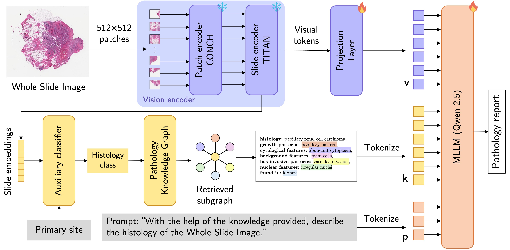

<h1 align="center">PathKGen: Pathology Knowledge Assisted MLLM for Explainable Histopathology</h1>
<p align="center">
  Nadun Rajapaksha*, Sandun Herath*, Devnith Wijesinghe*, Isiri Withanawasam*, Hasindri Watawana, Ranga Rodrigo
  <br>
  <small>(* indicates equal contribution)</small>
</p>

<!-- Replace the Project Page href with the release URL. -->
<p align="center">
  <a href="https://arxiv.org/abs/2610.33691"></a>
  <a href="https://huggingface.co/deepshark43/pathkgen"></a>
  <a href="https://huggingface.co/datasets/deepshark43/wsi_bench_pathkgen"></a>
  <a href="https://deepshark-uom.github.io/PathKGen/"></a>
</p>

> This paper has been accepted to WACV 2027! 🎉



## Overview
We introduce PathKGen, a knowledge graph–assisted MLLM for histopathology report generation. PathKGen has two main branches: (1) a visual path that learns visual token inputs to the MLLM using pathology foundation models, and (2) a knowledge path that learns knowledge token inputs by extracting key morphological features of WSIs through querying a pathology-specific knowledge graph.

---

## Usage

### 1. Environment Setup

```bash
git clone https://github.com/nadunnr/PathKGen.git
cd PathKGen

conda env create -f environment.yml
conda activate vlm        # or: pip install -r requirements.txt
```

> Tested with CUDA 12.1.

### 2. Download Data and Weights

From the repository root (`data/`, `checkpoints/` and `results/` resolve relative to it; `export VLM_ROOT=/path/to/PathKGen` to use another location):

```bash
# Dataset -> data/dataset/, data/slide_features/{train,test}/
hf download deepshark43/wsi_bench_pathkgen --repo-type dataset --include "data/*" --local-dir .

# PathKGen weights -> checkpoints/pathkgen_weights/{pathkgen_stage1,pathkgen_stage2}/
hf download deepshark43/pathkgen --local-dir checkpoints

# Base LLM -> checkpoints/Qwen2.5-7B-Instruct/
hf download Qwen/Qwen2.5-7B-Instruct --local-dir checkpoints/Qwen2.5-7B-Instruct
```

The [dataset](https://huggingface.co/datasets/deepshark43/wsi_bench_pathkgen) holds the WSI-Bench train/test JSONs with pre-curated knowledge prompts (from a UMLS-derived knowledge graph, anchored on auxiliary classifier predictions) and pre-computed slide features (CONCH v1.5 patch features aggregated by TITAN: 1D slide features and 2D visual tokens), so no pre-processing is needed (~9,650 small files: if an anonymous download hits HTTP 429, run `hf auth login` first). The [weights](https://huggingface.co/deepshark43/pathkgen) are `stage1.pt` (~94 MB) and `checkpoint_epoch_1.pt` (~11.7 GB).

### 3. Training

Run from `pipeline/`. Skip this step to use the released weights.

```bash
cd pipeline
bash train_stage1.sh    # projection alignment (LLM frozen) -> checkpoints/stage1_wsi_bench_qwen7b/<run>/

bash train_stage2.sh    # knowledge-guided: projection + LoRA, BLEU-penalised loss
```

Stage 2 starts from the released Stage 1 weights by default. To start from your own, run `STAGE1_CHECKPOINT=<path>/checkpoint_epoch_8.pt bash train_stage2.sh`.

### 4. Inference

Runs the released Stage 2 weights on the WSI-Bench test set (for your own checkpoint: `STAGE2_CHECKPOINT=<path> bash inference.sh`):

```bash
cd pipeline
bash inference.sh
```

`results/inference_wsi_bench/` gets `predictions.json` (generated reports) and `metrics.json` (BLEU-1/2/3/4, METEOR, ROUGE-L). To plot the curves of your own training runs, from `pipeline/`:

```bash
python plot_training.py --stage1_history <stage1_run>/training_history.json --stage2_history <stage2_run>/training_history.json
```

### 5. Optional: Rebuild Data from Scratch

Not needed for the steps above, since the released dataset already contains these outputs. Run from the repository root, in order (inputs are under `data/`):

```bash
bash pre_processing/encode_slide_features.sh /path/to/TRIDENT   # slide features (CONCH v1.5 + TITAN)
bash pre_processing/preprocess_wsi_bench.sh                     # convert + filter WSI-Bench
bash pre_processing/build_knowledge_graph.sh                    # Neo4j knowledge graph + top CUIs
bash pre_processing/build_knowledge_prompts.sh                  # auxiliary classifier + knowledge prompts
```

| Script | Needs |
|---|---|
| `encode_slide_features.sh` | [TRIDENT](https://github.com/mahmoodlab/TRIDENT) (its TITAN code modified to also save the 2D visual tokens); `.svs` slides in `temp_wsis/`. Move the output `.h5` files into `slide_features/{train,test}/`. |
| `preprocess_wsi_bench.sh` | `wsi_bench/dataset_raw/WSI-Bench-{train.json,test.jsonl}`; `slide_features/{train,test}/` |
| `build_knowledge_graph.sh` | Neo4j credentials set in `knowledge_path/graphs.py` and `knowledge_path/graph_construct/cui_selecter.py`; `UMLS_sql/neo4jdb/v8/*.csv`; `wsi_bench/kg_data/cui_jsons/` |
| `build_knowledge_prompts.sh` | `wsi_bench/kg_data/descriptions.json`; `wsi_bench/custom_kg/relations.csv`; output of `preprocess_wsi_bench.sh` |

---

## Citation

If you find this work useful, please cite:

```bibtex
@article{rajapaksha2026pathkgen,
  title={PathKGen: Pathology Knowledge Assisted MLLM for Explainable Histopathology},
  author={Rajapaksha, Nadun and Herath, Sandun and Wijesinghe, Devnith and Withanawasam, Isiri Amani and Watawana, Hasindri and Rodrigo, Ranga},
  journal={arXiv preprint arXiv:2610.33691},
  year={2026}
}
```
